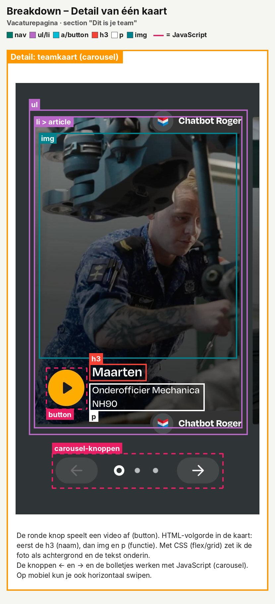
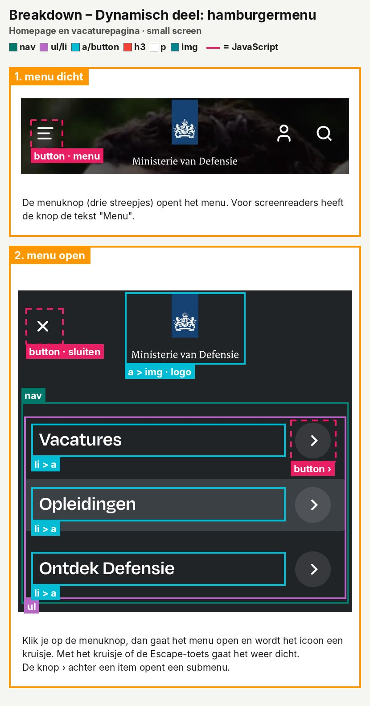
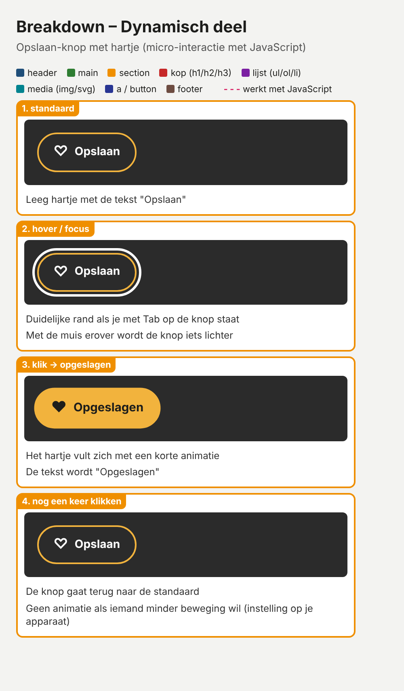

# Procesverslag
Markdown is een simpele manier om HTML te schrijven.  
Markdown cheat cheet: [Hulp bij het schrijven van Markdown](https://github.com/adam-p/markdown-here/wiki/Markdown-Cheatsheet).

Nb. De standaardstructuur en de spartaanse opmaak van de README.md zijn helemaal prima. Het gaat om de inhoud van je procesverslag. Besteedt de tijd voor pracht en praal aan je website.

Nb. Door *open* toe te voegen aan een *details* element kun je deze standaard open zetten. Fijn om dat steeds voor de relevante stuk(ken) te doen.

## Jij

  
uitwerken voor kick-off werkgroep

  ### Auteur:
  Stijn Bruins

  #### Je startniveau:
  Blauwe piste. Ik vind coderen lastig. Met hulp lukt het meestal wel. Omdat ik dit vak herkans, wil ik vooral zorgen dat de basis goed staat en dat ik mijn code goed begrijp.

  #### Je focus:
  Responsive. Ik wil dat mijn website goed werkt en er goed uitziet op alle schermen, van een kleine telefoon tot een groot beeldscherm. Als UX/UI-student vind ik het belangrijk     dat een site op elk apparaat prettig te gebruiken is.
 

## Je website

  
uitwerken voor kick-off werkgroep

  ### Je opdracht:
  Ik ga twee pagina's namaken van [Werken bij Defensie](https://werkenbijdefensie.nl/). Ik vind de stoere huisstijl van deze site heel gaaf: de donkere achtergrond, de gele accentkleur en de grote koppen. De twee pagina's zijn een overzichtspagina en een detailpagina, waardoor er veel verschillende content in zit.

  Mijn micro-interactie wordt de **Opslaan-knop met hartje** op de vacaturepagina.

  #### Screenshot(s) van de eerste pagina (small screen): 
  Homepage – [werkenbijdefensie.nl](https://werkenbijdefensie.nl/)  
  

  #### Screenshot(s) van de tweede pagina (small screen):
  Vacature Korporaal Allround Monteur – [werkenbijdefensie.nl/vacatures/.../korporaal-allround-monteur](https://werkenbijdefensie.nl/vacatures/militaire-vacatures/korporaal-allround-monteur-e14502)  
  
 

## Toegankelijkheidstest 1/2 (week 1)

  
uitwerken na test in 2e werkgroep

  ### Bevindingen
  Ik heb de homepage en de vacaturepagina (Korporaal Allround Monteur) van werkenbijdefensie.nl getest met de WCAG checklist van FED. Ik heb getest in Chrome op mijn MacBook en met de telefoonweergave (iPhone SE).

  **Wat goed gaat**
  - Met **Tab** kan ik door de hele pagina en ik zie steeds waar ik ben.
  - Er is een **skip link** ("Naar hoofdinhoud").
  - De site werkt ook **liggend** op een telefoon.
  - Op **200% zoom** is alles nog leesbaar en te gebruiken.
  - Het **kleurcontrast** is goed: witte tekst op een donkere achtergrond en donkere tekst op de gele knoppen.
  - De pagina's hebben `lang="nl"`, een **unieke title** en zoomen is niet uitgezet.
  - De vacaturepagina houdt rekening met **prefers-reduced-motion**.

  **Wat beter kan**
  - De **homepage heeft geen h1**, alleen h2's. De vacaturepagina heeft wel één h1.
  - **Alle afbeeldingen hebben een lege alt-tekst**, ook foto's die wel iets betekenen (zoals de kaarten Militair, Burger, enz.). Een screenreader slaat ze dan over.
  - De **video bovenaan de homepage start vanzelf**. Er is wel een pauzeknop, maar geen ondertiteling.
  - **Linkteksten zijn niet uniek**: "Bekijk vacatures" staat er 14 keer en "Ontdek meer" 12 keer. Met een screenreader weet je dan niet waar een link naartoe gaat.
  - Op de vacaturepagina zijn een paar **"nep-knoppen"** (een div of span in plaats van een button).
  - Links naar social media openen in een **nieuw tabblad** zonder dat dat wordt aangegeven.
  - Er is **geen licht thema**: de site blijft altijd donker.
  - De titel **"Tijd vo:or Defensie"** is lastig te lezen en een screenreader leest hem raar voor.

  **Wat ik in mijn versie ga verbeteren**
  - Eén duidelijke h1 op elke pagina.
  - Beschrijvende alt-teksten bij foto's die iets betekenen.
  - Duidelijke, unieke linkteksten (bijvoorbeeld "Bekijk vacatures Techniek").
  - Echte `button`-elementen voor knoppen.
  - Een licht én donker thema.
  - De titel schrijf ik als gewone tekst ("Tijd voor Defensie") en ik maak alleen het effect met CSS.

## Breakdownschets (week 1)

  
uitwerken na afloop 3e werkgroep

  ### de hele pagina: 
  Homepage  
  

  Vacaturepagina Korporaal Allround Monteur  
  

  ### detail van één kaart:
  Teamkaart uit "Dit is je team" op de vacaturepagina  
  

  ### dynamisch deel (bijv menu): 
  Het hamburgermenu (dicht en open)  
  

  ### wellicht nog een dynamisch deel (bijv filter): 
  De Opslaan-knop met hartje (mijn micro-interactie)  
  

## Voortgang 1 (week 2)

  
uitwerken voor 1e voortgang

  ### Stand van zaken
  hier dit ging goed & dit was lastig (neem ook screenshots op van delen van je website en code)

  ### Agenda voor meeting
  samen met je groepje opstellen

  | student 1      | student 2          | student 3    | student 4        |
  | ---            | ---                | ---          | ---              |
  | dit bespreken  | en dit             | en ik dit    | en dan ik dat    |
  | en dat ook nog | dit als er tijd is | nog een punt | dit wil ik zeker |
  | ...            | ...                | ...          | ...              |

  ### Verslag van meeting
  hier na afloop snel de uitkomsten van de meeting vastleggen

  - punt 1
  - punt 2
  - nog een punt
  - ...

## Voortgang 2 (week 3)

  
uitwerken voor 2e voortgang

  ### Stand van zaken
  hier dit ging goed & dit was lastig (neem ook screenshots op van delen van je website en code)

  ### Agenda voor meeting
  samen met je groepje opstellen

  | student 1      | student 2          | student 3    | student 4        |
  | ---            | ---                | ---          | ---              |
  | dit bespreken  | en dit             | en ik dit    | en dan ik dat    |
  | en dat ook nog | dit als er tijd is | nog een punt | dit wil ik zeker |
  | ...            | ...                | ...          | ...              |

  ### Verslag van meeting
  hier na afloop snel de uitkomsten van de meeting vastleggen

  - punt 1
  - punt 2
  - nog een punt
- ...

## Toegankelijkheidstest 2/2 (week 4)

  
uitwerken na test in 9e werkgroep

  ### Bevindingen
  Lijst met je bevindingen die in de test naar voren kwamen (geef ook aan wat er verbeterd is):

## Voortgang 3 (week 4)

  
uitwerken voor 3e voortgang

  ### Stand van zaken
  hier dit ging goed & dit was lastig (neem ook screenshots op van delen van je website en code)

  ### Agenda voor meeting
  samen met je groepje opstellen

  | student 1      | student 2          | student 3    | student 4        |
  | ---            | ---                | ---          | ---              |
  | dit bespreken  | en dit             | en ik dit    | en dan ik dat    |
  | en dat ook nog | dit als er tijd is | nog een punt | dit wil ik zeker |
  | ...            | ...                | ...          | ...              |

  ### Verslag van meeting
  hier na afloop snel de uitkomsten van de meeting vastleggen

  - punt 1
  - punt 2
  - nog een punt
  - ...

## Eindgesprek (week 5)

  
uitwerken voor eindgesprek

  ### Je uitkomst - karakteristiek screenshots:
  

  ### Dit ging goed/Heb ik geleerd: 
  Korte omschrijving met plaatjes

  

  ### Dit was lastig/Is niet gelukt:
  Korte omschrijving met plaatjes

  

## Bronnenlijst

  
continu bijhouden terwijl je werkt

  Nb. Wees specifiek ('css-tricks' als bron is bijv. niet specifiek genoeg). 
  Nb. ChatGpT en andere AI horen er ook bij.
  Nb. Vermeld de bronnen ook in je code.

  1. [The A11Y Project – Checklist](https://www.a11yproject.com/checklist/) – gebruikt bij de toegankelijkheidstest.
  2. [WebAIM Contrast Checker](https://webaim.org/resources/contrastchecker/) – kleurcontrast getest.

